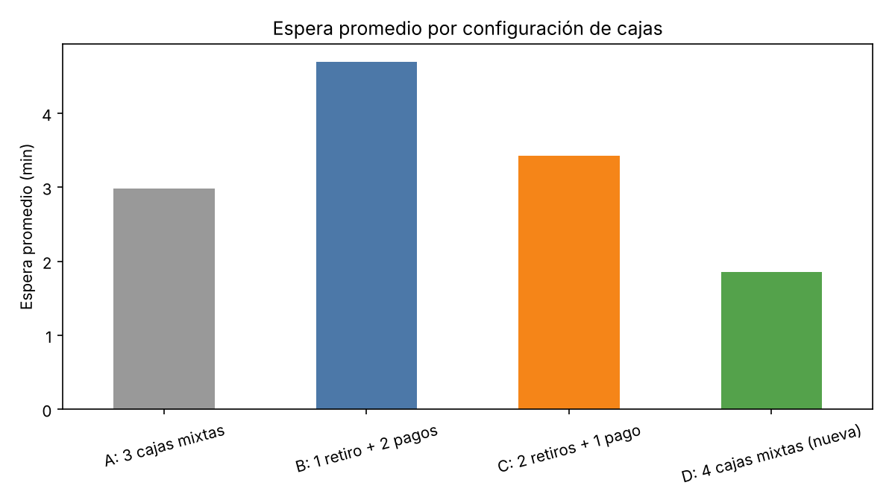

# 🏦 Simulación de cajas – Banco de Colombia

Simulación en Python de las 3 cajas de un banco (colas **M/M/1** independientes) para decidir
cuántas cajas deben ser exclusivas para **retiros** y cuántas para **pagos/consignaciones**, y
si hace falta una cuarta caja.

## 📁 Estructura del repositorio

```
banco-cajeros-simulacion/
├── README.md                      ← este archivo
├── requirements.txt               ← dependencias
├── .gitignore
├── src/
│   └── simulacion_banco.py        ← código principal (script)
├── notebooks/
│   └── simulacion_banco_cajeros.ipynb   ← versión para Google Colab (ideal para exponer)
└── resultados/                    ← evidencias generadas por el código
    ├── resultados.txt             ← reporte completo de los 5 puntos
    ├── p1_atencion_por_cajero.csv
    ├── p2_promedio_usuarios_por_tipo.csv
    ├── p3_usuarios_por_replica.csv
    ├── p4_comparacion_escenarios.csv
    ├── p4_espera_por_accion.csv
    └── grafica_espera_promedio.png
```

## ⚙️ Modelo y supuestos

- 3 cajas, cada una es una cola M/M/1 independiente; atención inmediata y desplazamiento despreciable.
- El banco opera 8 horas (480 min). Se simula **1 día con 10 réplicas**.
- 70 % de los clientes hacen retiros y 30 % pagos; dentro de cada acción el tipo de usuario
  (rápido, normal, lento, muy lento) se asigna con las probabilidades de la Tabla 2.
- El tiempo entre llegadas y el tiempo de servicio son **exponenciales** con las medias de la Tabla 1
  para el tipo de cliente que llega.
- Cada cliente elige al azar una de las cajas habilitadas para su servicio.
- Los 4 escenarios usan los **mismos clientes** en cada réplica para una comparación justa:
  - **A:** 3 cajas mixtas
  - **B:** 1 caja de retiros + 2 de pagos
  - **C:** 2 cajas de retiros + 1 de pagos
  - **D:** 4 cajas mixtas (caja nueva)

> Nota: el enunciado no indica cómo combinar las Tablas 1 y 2, por lo que se adoptó el supuesto anterior.

## ▶️ Instrucciones de ejecución

### Opción 1 – Google Colab (recomendada)
1. Entra a <https://colab.research.google.com>.
2. *Archivo → Subir cuaderno* y selecciona `notebooks/simulacion_banco_cajeros.ipynb`.
3. Ejecuta todo: *Entorno de ejecución → Ejecutar todas* (Ctrl+F9).

### Opción 2 – Local (Python 3.9+)
```bash
git clone <URL-del-repositorio>
cd banco-cajeros-simulacion
python -m venv .venv
source .venv/bin/activate          # En Windows: .venv\Scripts\activate
pip install -r requirements.txt
python src/simulacion_banco.py
```
Los resultados se guardan en la carpeta `resultados/`. La semilla es fija, por lo que
los resultados son reproducibles.

## 📊 Resultados obtenidos

| Punto | Resultado |
|-------|-----------|
| 1. Atención por cajero | Menor: **Caja 3 (3,03 min)** · Mayor: **Caja 1 (3,33 min)** |
| 2. Usuarios promedio por día | ≈ **134 retiros** y ≈ **57 pagos** (detalle en `p2_...csv`) |
| 3. Usuarios por réplica | Réplica con menos usuarios: **#9 (162 usuarios)** (detalle en `p3_...csv`) |
| 4. ¿Nueva caja? | **Sí**: la espera baja de 2,98 a 1,85 min y los que esperan >5 min pasan de 18,6 % a 12,1 % |
| 5. Cajas exclusivas | **2 para retiros y 1 para pagos** |

### Comparación de escenarios

| Escenario | Espera prom. (min) | Tiempo en sistema (min) | Espera máx. (min) | % espera > 5 min |
|-----------|-------------------:|------------------------:|------------------:|-----------------:|
| A: 3 mixtas | 2,98 | 6,12 | 38,44 | 18,60 |
| B: 1 retiro + 2 pagos | 4,70 | 7,85 | 48,76 | 30,67 |
| C: 2 retiros + 1 pago | 3,43 | 6,58 | 70,29 | 19,07 |
| D: 4 mixtas (nueva) | 1,85 | 5,00 | 32,36 | 12,07 |



## ✅ Conclusiones

- Entre las opciones **exclusivas**, **2 cajas de retiros + 1 de pagos** es mejor (3,43 min) que
  1 + 2 (4,70 min), porque los retiros son el 70 % de la demanda.
- Con esa opción, los pagos esperan más (≈ 7,9 min); las 3 cajas mixtas son la alternativa más equilibrada (2,98 min).
- **Sí conviene una cuarta caja:** reduce la espera promedio en ~38 %.
- Con otra semilla los valores cambian ligeramente; las conclusiones se mantienen.

## 🛠️ Tecnologías
Python · NumPy · pandas · Matplotlib
